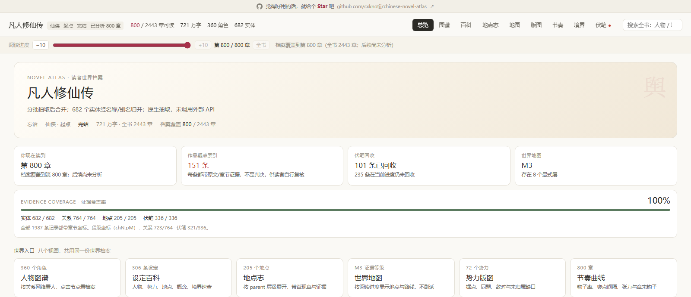
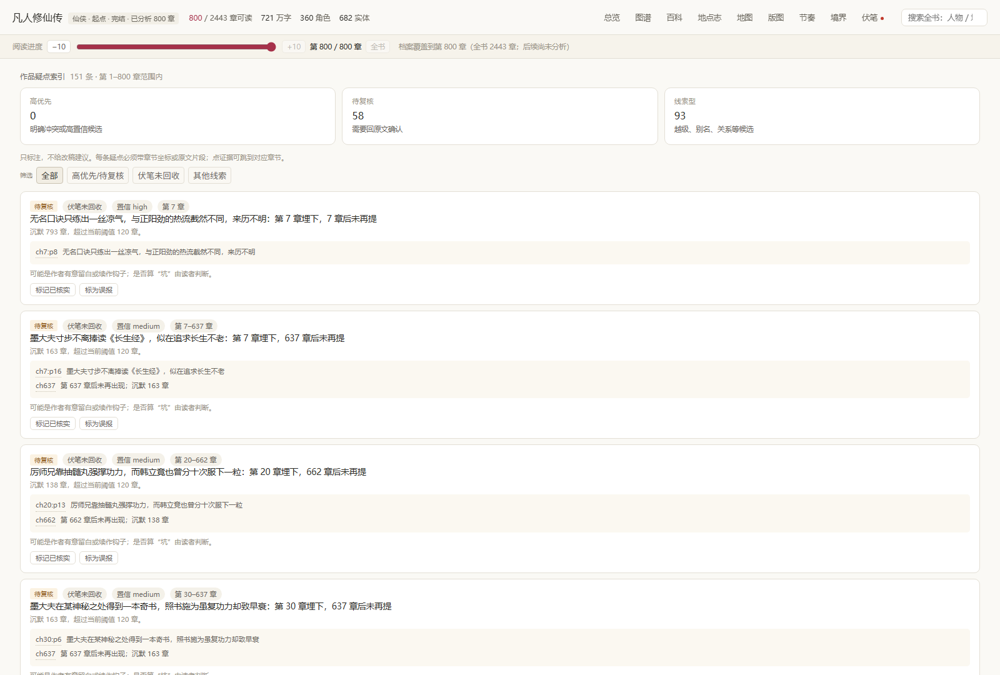
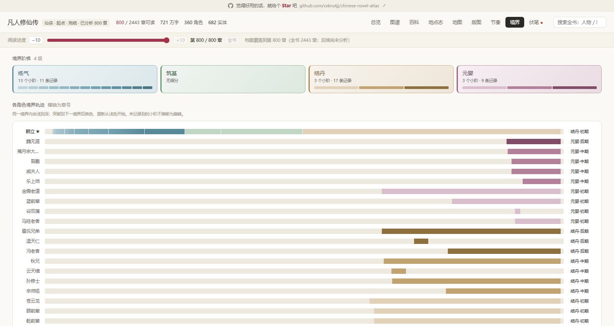

# Novel Atlas

**把一本 200 万字的网文，做成能边看边查的世界百科——读到第 47 章，就只显示到第 47 章的设定，不剧透后面。**

[](https://github.com/cxknotjj/chinese-novel-atlas)
[](https://github.com/cxknotjj/chinese-novel-atlas/actions/workflows/contract.yml)
[](LICENSE)


**[八视图档案](http://deerfect.me/chinese-novel-atlas/demo/)** ·
**[读者站（按阅读进度截断，不剧透）](http://deerfect.me/chinese-novel-atlas/demo/reader/)** ·
[数据契约](references/schema.md) ·
[功能文档](docs/功能文档.md) ·
[English](README_EN.md)



同一份 `data.json` 投影出八个视图：人物图谱、设定百科、地点志、世界地图、势力版图、节奏曲线、境界轨迹、伏笔台账。拖动顶部进度条，整站内容跟着截断到你读到的那一章。

---

## 为什么是 Skill 而不是网页

- **核心是 6 个 Agent Skill。** 分析、问答、对比、导出、地图、疑点复核都能被 Agent 直接调用；`reader/` 和 `atlas.html` 只是同一份数据的发布面。
- **每条结论都能回到原文。** 人物、地点、关系、伏笔、地图节点都带 `chN:pM` 坐标；没有证据的推断不写入档案。
- **一份 `data.json` 投影成多种产物。** 读者站、单文件八视图、地图、设定集、角色表、跨书指标，共享同一套实体与证据。
- **读者向，不剧透。** 用 `cutoff_ch` 按阅读进度截断人物、关系、伏笔和地图层；未来内容默认锁定。
- **视觉不是贴图。** 地图由 21 件手绘 PNG + 9 类代码/SVG 变量层组成；境界轨迹用多色相时间线，同境界由浅到深，突破后换色重新变浅。

## 用 STAR 看懂

| | |
|---|---|
| **S — Situation** | 一本完本网文动辄几十万到几百万字，人物、地点、伏笔、境界和地图散落在几千章正文里。 |
| **T — Task** | 把整本书拆成可查询、可复核、可按阅读进度发布的世界档案，而不是再做一个读完就忘的摘要页。 |
| **A — Action** | 用 6 个 Skill 跑完「分批抽取 → 合并校验 → 疑点/地图/读者站投影」，所有结论落到 `data.json` 和原文坐标。 |
| **R — Result** | 读者能按进度逛人物、地点、关系、伏笔、境界和地图；研究者能拿同一份数据做问答、对比与二次导出。 |

---

## 效果

下面的截图不是概念图，是在《凡人修仙传》前 500 章上真实跑出来的。**在线 demo 就是这份档案**：

**[→ 打开在线档案](http://deerfect.me/chinese-novel-atlas/demo/)** · 384 实体 · 119 地点 · 215 伏笔

总览页直接给出**证据覆盖率**：多少实体/关系/地点/伏笔带章节坐标、其中多少精确到段落（`chN:pM`），并随阅读进度实时重算。

| | |
|---|---|
| 原文 | 2443 章 · 720.9 万字 |
| 本次分析 | 前 500 章（占 20%） |
| 产出 | 384 实体（199 角色）· 459 关系 · 119 地点 · 215 伏笔 |
| 成本 / 耗时 | 约 ¥5 · 40 分钟（8 并发，DeepSeek） |

跑完得到三个结论：

**一、215 条伏笔里，79 条到第 500 章仍未回收。** 判据不是「埋了多久」，而是**多久没被再提过**——第 7 章埋、第 196 章还在提的主线不该报警；第 20 章埋、第 73 章后再没出现的才该报。这一条否掉了两种常见做法，理由见[判定规则](references/schema.md#status-判定规则)。

**二、沉默最久的一条从第 7 章起就没再出现，跨 493 章。** 它是韩立修行的起点（一丝与正阳劲截然不同的凉气），此后再未被文本提及。工具标「超期」是对的——对读者来说，这个来历确实悬了 493 章。

**三、原著用的是功法层数，不是「练气 / 筑基」。** 前 500 章里标准境界词几乎不出现。逐批抽取时 10 个批次有 9 个的 `realms` 是空的，剩下那个自己编了 `order: 1` 的「筑基」。所以境界必须**全局定义**（`realms.py` 全文扫描 → 人工确认 → `merge.py` 注入），不能由批次各自建立。这正是 [schema v2.1](references/schema.md) 那条硬约束的来历。

| 疑点索引：每条带证据，可标已核实/误报 | 境界轨迹：多色相 + 同境界浅到深 |
|---|---|
|  |  |


> **「未回收」不等于「作者忘了」。** 只分析了前 500 章，全书 2443 章，大量线索在第 500 章后才收。准确表述是「到第 500 章为止仍未回收」——这是读者视角的事实记录，不是对作品的判断。原文与分析档案不随仓库分发（`novals/`、`output/` 均已忽略）。

读者站与地图在 500px 宽度下可用；地图桌面端右键拖拽平移、移动端单指拖拽平移，缩放百分比实时显示。

每个视图都有独立地址：`?view=graph`、`?view=map`、`?view=foreshadow`……刷新或分享都停在同一页；再带上 `?cutoff=349` 就能连同阅读进度一起分享。

---

## 一个 Skill · 六个流程

六个流程装一次就有：入口 `SKILL.md` 只做意图路由，按需读 `references/*.md`，不把六份流程一次塞进上下文。

| 流程 | 自然语言入口 | 职责 | 主要产物 |
|---|---|---|---|
| `analyze` | “分析《我的书》完本” | 分章、批次抽取、合并、校验、快照 | `data.json`、`atlas.html` |
| `ask` | “韩立第几章筑基？” | 先查结构，再回原文；答案带坐标 | 带 `chN:pM` 的回答 |
| `compare` | “对比两本书的伏笔回收率” | 节奏、伏笔、战力、势力、疑点密度 | `metrics.md`、`diff.json`、`compare.html` |
| `export` | “导出《我的书》读者站” | 读者站 / 单文件 / 设定集 / 角色表 | `reader/`、`atlas.html`、MD/CSV |
| `map` | “给《我的书》做地图” | M0–M4 分级、JSON 编排、地图审计、渲染 | `map_layout`、PNG/SVG、地图页 |
| `audit` | “复核《我的书》的疑点” | 疑点列表、证据回看、标记已核实/误报；可选 `--web` 联网核对（只碰别名/归属/术语等非剧情字段） | `anomalies-verdicts.json`、`review/web-leads.md` |

把 `skills/novel-atlas/` 挂到 Agent 的 skill root（或让 Agent 直接读它的 `SKILL.md`）即可；不需要启动服务，也不调用外部模型 API。

---

## 安装

```bash
npx skills add cxknotjj/chinese-novel-atlas -y -g
```

`-g` 全局安装，所有目录可用；去掉 `-g` 只装到当前目录。更新时重跑同一条命令即可。

**skill 是自包含的**：`novel-atlas` 约 2.1MB，`scripts/`、`template/`、`references/` 都随它一起装进去（六个流程共用同一套脚本与模板，不再各带一份），装完即可运行，**不需要 clone 仓库**。唯一的例外是地图渲染需要仓库里 20MB 的 `atlas-kit/` 手绘素材。资源由 `scripts/sync_skills.py` 从源码同步，CI 会校验副本与源码逐字节一致。

装完后在你正在用的 Agent（Claude Code / Codex / 任何能读 `SKILL.md` 的工具）里直接说：

> 拆《我的书》

六个 skill 会按需加载，不需要单独配模型或起服务。

### 装不上怎么办

`npx` 内部是 `git clone github.com`。如果卡在 `Cloning repository…`（国内网络常见），换这两条路：

**A. 作为 Claude Code 插件**

```bash
/plugin marketplace add cxknotjj/chinese-novel-atlas
/plugin install novel-atlas
```

**B. 下载 ZIP 手动放**

1. 下载 <https://github.com/cxknotjj/chinese-novel-atlas/archive/refs/heads/master.zip>
2. 解压后把 `skills/novel-atlas/` 这一个目录拷进 skill root：Claude Code 是 `~/.claude/skills/`，WorkBuddy 是 `~/.workbuddy/skills/`
3. 重开会话，skill 列表里出现 `novel-atlas` 即成功

**唯一例外是地图流程**：地图渲染依赖 `atlas-kit/` 的 20MB 手绘素材，没法随 skill 分发，所以做地图时要有一份仓库：

```bash
git clone https://github.com/cxknotjj/chinese-novel-atlas.git
```

---

## 快速开始（命令行）

下面是从仓库根直接跑的用法（需先 clone）。五个 skill 自带同样的脚本，装好后不 clone 也能跑，把 `scripts/` 换成 `<SKILL_DIR>/scripts/` 即可。

### 1. 分析一本完本小说

输入支持 `.txt`（utf-8 / GBK / Big5 自动探测）、`.md`、`.epub`，直接给路径即可，不用预转换。

按 [`skills/novel-atlas/SKILL.md`](skills/novel-atlas/SKILL.md) 与 `references/analyze.md` 执行。CLI 负责切分、合并、校验和构建，逐批抽取由执行 Agent 完成：

```bash
python scripts/chunk.py "path/我的书.txt" --out output/我的书
python scripts/merge.py output/我的书 --genre 仙侠 --platform 起点
python scripts/mentions.py output/我的书 --apply
python scripts/validate.py output/我的书/data.json
python scripts/build.py --data output/我的书/data.json --out output/我的书
```

每批 10 章，抽取结果写成批次 JSON，原文不进入最终档案。长书（100 章以上）建议把批次分给多个子 Agent 并行抽取，父 Agent 只做分派、逐批验收和最终 merge——产物与串行一致，只是更快；约束见 SKILL.md 第 2 步。

### 2. 问答与对比

```bash
python scripts/seek.py --dir output/我的书/ --keyword "韩立第几章筑基" --context 2
python scripts/compare.py --a output/A/data.json --b output/B/data.json --out output/_compare
```

### 3. 疑点索引与复核

```bash
python scripts/anomalies.py --data output/我的书/data.json
python skills/novel-atlas/scripts/audit.py stats --data output/我的书/data.json
python skills/novel-atlas/scripts/audit.py list  --data output/我的书/data.json --severity warning
```

`--cutoff N` 可只保留证据不晚于第 N 章的疑点；复核结果写入 `anomalies-verdicts.json`，不修改原索引。

### 4. 生成读者站

```bash
python scripts/build_reader.py --data output/我的书/data.json --out output/我的书/reader --single
python scripts/build_reader.py --data output/我的书/data.json --out output/我的书/reader --cutoff 120 --allow-partial
```

- 默认要求 `coverage.chapters_done == meta.chapters`；只分析了前 N 章时加 `--allow-partial`，manifest 会写 `publishable: false`。
- `--cutoff N` 生成真正冻结到第 N 章的副本；不传时页面默认全书，读者拖动进度条只在已分析范围内取 `?cutoff=`。
- `--single` 单文件；不加则 external 静态站（`index.html` + `data.js`）。
- 读者站同时产出 `anomalies.json` 与 `reader-manifest.json`。

### 5. 地图

```bash
python skills/novel-atlas/scripts/atlas_map.py --project-root . levels --data output/我的书/data.json
python skills/novel-atlas/scripts/atlas_map.py --project-root . audit  --data output/我的书/data.json
```

地图是 `map` 流程的输出，不是产品入口：

1. **M0–M4 自动分级**：M0 地点索引；M1 拓扑/示意；M2 方向/距离证据 ≥3 条；M3 多层；M4 `time_slices` 时态切片。
2. **网页编排器**：示意 2D 里点「编排」，拖节点、给节点选层、挂/移除 21 件底件、导出 `map-layout.json`；M4 数据出现时间切片下拉；PNG/SVG 导出当前视图。
3. **读者版截断**：只画 `first_ch <= cutoff_ch` 的区域、节点、路线、stamp；未来层不画。
4. **示意 2D 可以随机摆放**：`map_layout` 只保证 `places.parent` 包含关系；原文没写方位时可随机/自动摆放并避开建筑。坐标仍不是经纬度或原文方位证据，只有 `spatial_relations` 的 direction/distance 才对回原文。
5. **缩放不裁装饰**：地图内容随缩放变化，纸底、题签和工具条保持屏幕尺寸；桌面右键拖拽、移动端单指拖拽平移，缩放百分比实时更新。

---

## 数据契约

`data.json` 是唯一事实源，schema v2.0。读者向派生字段：

| 字段 | 说明 |
|---|---|
| `anomalies` | 疑点数组；每条必须有 `id`、`evidence` |
| `_anomalyMeta` | 阈值、live 章、统计、规则错误 |
| `_mapLevels` | 地图 M0–M4 分级与每层方向约束数 |
| `_reader` | `cutoff_ch / analyzed_ch / chapter_max / total_chapters / analysis_complete / is_spoiler_safe` |

完整字段、`cutoff_ch` 投影规则、疑点对象、`map_layout` 与 `time_slices` 契约见 [`references/schema.md`](references/schema.md)。

**硬规则**：所有实体、地点、关系、伏笔、地图节点都要能回到 `chN:pM`；没有证据不进入结论。疑点只给证据和可能解释，不给“应该怎么改”。

---

## Reader 只是发布面

`export` 流程把同一份 `data.json` 投影成读者站。它做三件事：

- **按章截断**：实体、地点、势力、关系、伏笔、地图层、疑点都受 `cutoff_ch` 约束；
- **不剧透**：未来节点不显示，未来命中只提示“第 N 章后解锁”；
- **证据可回看**：疑点、伏笔、地点都带 `chN:pM`，点击可跳到章节。

页面入口：

```text
reader/index.html    静态读者站
atlas.html           单文件八视图
anomalies.json       疑点索引
reader-manifest.json coverage / cutoff / 地图等级 / 疑点可见数
```

---

## 输出结构

```text
output/我的书/
  data.json               schema v2.0；唯一事实源
  anomalies.json          疑点索引
  anomalies-verdicts.json 人工复核（可选，不修改 anomalies.json）
  atlas.html              单文件八视图
  reader/
    index.html            读者站入口
    data.js               external 模式的数据
    anomalies.json
    reader-manifest.json  coverage / cutoff / 地图等级 / 疑点可见数
  versions/
    v1.json / latest.json 版本快照
```

## 版本与重跑

```bash
python scripts/snapshot.py --data output/我的书/data.json --label 500章
python scripts/snapshot.py --diff output/我的书/versions/v1.json output/我的书/versions/v2.json
```

快照记录 fingerprint、counts、实体/地点/伏笔/概念 `name → id` 映射；`diff` 输出新增、删除、ID 漂移。重跑/换版后同名对象换 ID 会被标出来。

---

## 测试与 CI

```bash
python -m unittest discover -s tests -v
```

覆盖 schema 校验、图片内联、模块拼装、导出、合并、读者 cutoff、疑点规则、版本 diff、地图 M0–M4、读者站 annotate、地图拖拽/缩放百分比、伏笔状态筛选、境界配色。CI 在 `.github/workflows/contract.yml` 跑样例校验、测试和构建。

---

## 不做什么

- 不写小说、不续写、不改文风。
- 不做作者工作台、连载提醒、改稿清单、编辑审稿流。
- 不做通用 RAG 聊天；先查结构，再回原文，答案必须带坐标。
- 不做精确 GIS；示意地图不承担经纬度、比例尺、真实海岸线。
- 不做 SaaS 书库；默认本地，稿件不上传、不训练。
- 不继续加 tabs；八视图够多，下一步是收口成读者档案。

---

## 目录

```text
skills/               六个 Agent Skill（产品本体，自带 scripts/template/references）
scripts/              分析、合并、校验、导出、读者站、地图 CLI（源码）
scripts/sync_skills.py 把 CLI 同步进各 skill；--check 供 CI 校验副本一致性
references/schema.md  数据契约
atlas-kit/            21 件 PNG + 9 件变量层
template/             读者站渲染模板
template/viewer.js    薄入口，只负责 IIFE 和模块占位
template/viewer/      12 个按职责拆分的渲染模块（地图/图谱/百科/搜索等）
docs/功能文档.md       产品定义与验收标准
docs/screenshots/     README 效果截图（含《凡人修仙传》真实运行）
samples/fictional/    虚构样例
tests/                单元测试与契约回归
```

---

如果这套流程帮你把一本网文拆明白了，欢迎回到 [GitHub 仓库](https://github.com/cxknotjj/chinese-novel-atlas) 点一个 ⭐ Star。
