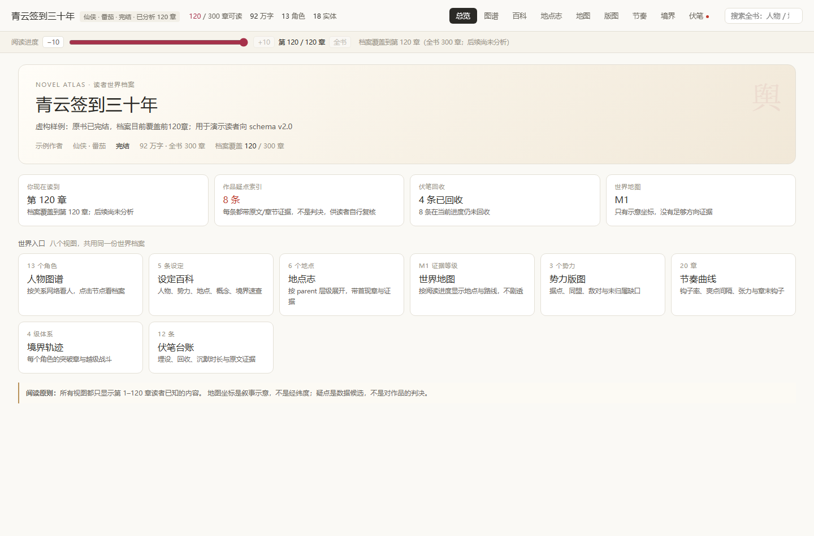

# Novel Atlas

**Turn a two-million-word web novel into a browsable world bible — read up to chapter 47, and the archive only shows what exists by chapter 47. No spoilers.**

[](https://github.com/cxknotjj/chinese-novel-atlas)
[](https://github.com/cxknotjj/chinese-novel-atlas/actions/workflows/contract.yml)
[](LICENSE)


**[Live demo](http://deerfect.me/chinese-novel-atlas/demo/)** · [中文版](README.md) · [Data contract](references/schema.md)



One `data.json` projects into eight views: character graph, encyclopedia, gazetteer, world map, faction map, pacing curve, cultivation-realm timeline, and a foreshadowing ledger. Drag the progress bar and the whole archive truncates to the chapter you've read.

---

## Why this exists

A Chinese web serial runs 2,000+ chapters and several million characters. Characters, places, factions, plot threads and power levels are scattered across all of it. If a reader at chapter 300 wants to check "who is this person again?", the only options are scrolling back or searching — and searching spoils the ending.

Novel Atlas parses the whole book into a structured archive, then publishes it truncated to a reading cutoff.

## Why skills, not a website

The product is six Agent Skills (Claude Code / Codex / any agent that reads `SKILL.md`). Analysis, Q&A, cross-book comparison, export, map generation and anomaly review are all invoked by natural language. `reader/` and `atlas.html` are just publication surfaces over the same data.

- **Every claim carries a source coordinate.** People, places, relations, plot threads and map nodes all reference `chN:pM`. Inferences without textual evidence are not written into the archive.
- **One dataset, many outputs.** Reader site, single-file eight-view HTML, map, setting compendium, character table, cross-book metrics.
- **Reader-facing, spoiler-free.** A `cutoff_ch` truncates characters, relations, plot threads and map layers to your reading progress.
- **Maps aren't stickers.** 21 hand-drawn PNG assets composited with 9 code/SVG variable layers.

## Install

```bash
npx skills add cxknotjj/chinese-novel-atlas -y -g
```

The skills are **self-contained**: `scripts/`, `template/` and `references/` ship inside each skill directory (`atlas-analyze` ~1.7 MB, the others ~0.2 MB each), so there is nothing to clone. Those copies are generated from source by `scripts/sync_skills.py`, and CI fails if a copy drifts from its source.

The one exception is `atlas-map`: map rendering needs the 20 MB hand-drawn `atlas-kit/` assets, which are not vendored. Clone the repo if you want to build maps.

## Quick start

```bash
# 1. split into chapters (pure text processing, no LLM)
python scripts/chunk.py path/to/novel.txt --out output/mybook/

# 2. extraction: the running agent reads 10-chapter batches and writes out/batch-XX.json
#    (no API key, no external client)

# 3. merge, track mentions, validate, build
python scripts/merge.py output/mybook/
python scripts/mentions.py output/mybook/ --apply
python scripts/validate.py output/mybook/data.json
python scripts/build.py --data output/mybook/data.json --out output/mybook/
```

Point your agent at `skills/` (or read the relevant `SKILL.md` directly). No server, no external model calls at render time.

Cost reference: 720k characters (500 chapters) costs about ¥5 / $0.7 of model usage.

## Design decisions worth arguing about

**Foreshadowing staleness is measured by silence, not by age.**
A thread planted at chapter 7 and still referenced at chapter 196 is being deliberately maintained — don't warn. A thread planted at chapter 20 and never mentioned after chapter 73 is the real problem. On the same book, judging by plant-chapter span flagged 37 overdue threads; judging by silence flagged 23, and the remaining ones were genuinely abandoned.

**Cultivation realms must be defined globally, never per batch.**
Extracting in batches of 10 chapters means each batch numbers realms independently. In practice this produced "Foundation Establishment" ranked as the *lowest* realm and an entirely empty power-history table across 105 entities. The fix: full-text scan → authoritative `realms.json` → merge-time injection.

**Every anomaly is a candidate, not a verdict.**
"Dead character reappears" might be a flashback. The tool surfaces evidence and lets the author mark it confirmed or false-positive.

## What this is not

- **Not GIS.** Maps are schematic; no coordinates, scale bars or real coastlines.
- **Not a SaaS.** Local by default. Manuscripts are never uploaded or used for training.
- **Not for short fiction.** The value comes from scale — 100+ chapters, 100+ characters.

## Limitations

- Entity extraction quality drops on classical/literary Chinese.
- Alias resolution degrades past ~500 characters.
- ~20% of plot threads lack a usable keyword, so their staleness falls back to plant-chapter distance (conservative).

## License

MIT. See [LICENSE](LICENSE).
