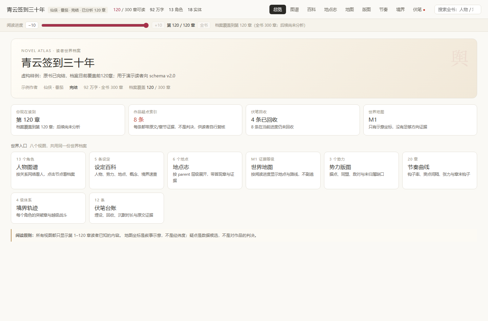
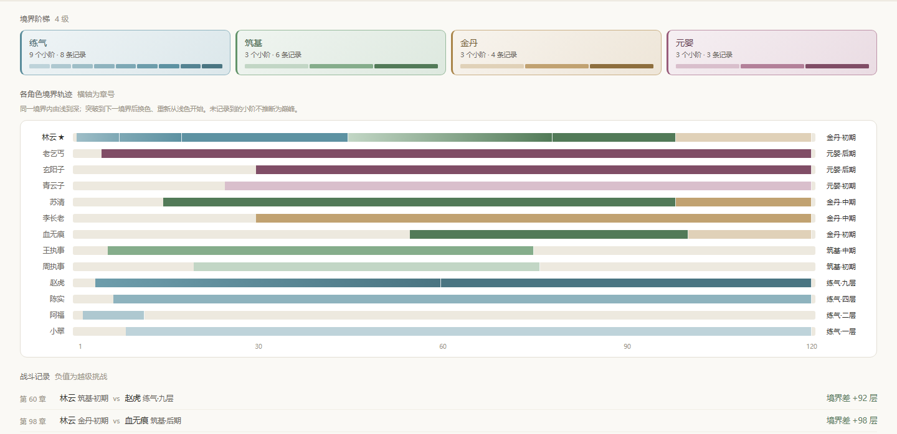
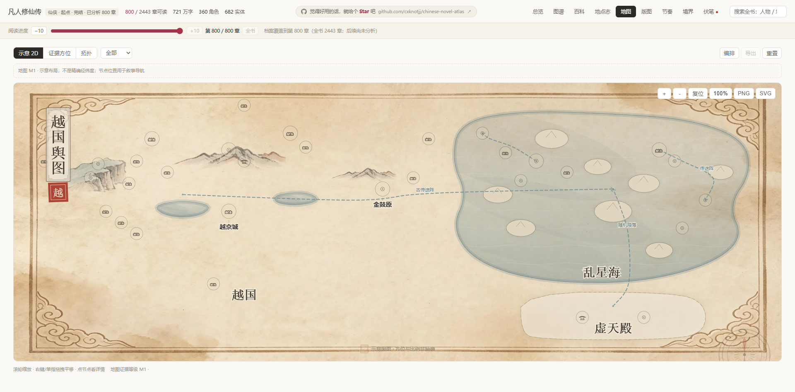

# 案例：《凡人修仙传》前 500 章

这是一次真实运行的记录，不是概念图。所有数字都能用仓库里的 CLI 复现。

**为什么放案例而不放原文**：原文的著作权属于原作者与版权方，本项目不公开原文，也不提供原文下载。下面的数字与界面都能用仓库里的 CLI 复现；在线可交互版本只含**分析结果**（人物、关系、地点、伏笔索引），不含任何章节正文。

**[→ 在线打开这份档案](http://deerfect.me/chinese-novel-atlas/demo/)**（384 实体 · 119 地点 · 215 伏笔）

---

## 规模

| | |
|---|---|
| 原文 | 2443 章，720.9 万字 |
| 本次分析 | 前 500 章（占全书 20%） |
| 抽取批次 | 50 批 × 10 章 |
| 产出实体 | 384（其中角色 199） |
| 产出关系 | 459 |
| 产出地点 | 119 |
| 产出伏笔 | 215 |
| 抽取成本 | 约 ¥5（DeepSeek，720 万字档） |
| 耗时 | 约 40 分钟（8 并发） |

跑完之后，`atlas.html` 是 1.7 MB 单文件，双击即开，无服务、无外部请求。



---

## 三个发现

### 一、215 条伏笔里，79 条到第 500 章仍未回收

| 状态 | 条数 |
|---|---|
| 已回收（`paid`） | 78 |
| 待回收（`planted`，仍在合理跨度内） | 58 |
| 超期（`overdue`） | **79** |

「超期」的判据不是「埋了多久」，而是**多久没被再提过**——这是这个项目与其它拆书工具最大的分歧点，理由见[伏笔判定规则](../references/schema.md#status-判定规则)。

### 二、沉默最久的一条，从第 7 章起就没再出现

| 埋设章 | 末次提及 | 沉默 | 内容摘要（非原文） |
|---|---|---|---|
| 7 | — | **493 章** | 无名口诀只练出一丝凉气，与正阳劲的热流截然不同，来历未交代 |
| 20 | 73 | 427 章 | 厉师兄靠抽髓丸强撑功力，韩立也曾分十次服下一粒 |
| 70 | 73 | 427 章 | 马门主屡次挑拨韩立与各派高层的关系 |
| 35 | 92 | 408 章 | 七绝堂书库角落藏着七十四本同名《眨眼剑谱》 |
| 77 | 95 | 405 章 | 野狼帮在七玄门外围安插奸细 |

排名第一的那条很有意思：它在**第 7 章**出现，此后再未被文本提及，而韩立后来凭它一路修到筑基。工具标它「超期」是对的——对读者来说，这个来历确实悬了 493 章。

### 三、境界体系是「功法层数」，不是「练气筑基」

这是让我改了两次架构的地方。

前 500 章里，「练气」「筑基」这类标准境界词几乎不出现，原著用的是**功法层数**（长春功第几层）。逐批抽取时，10 个批次里有 9 个的 `realms` 是空数组，剩下那个自己编了个 `order: 1` 的「筑基」。

修法是**境界必须全局定义**：先用 `realms.py` 全文扫描反推骨架，人工确认后写成 `realms.json`，再由 `merge.py` 统一注入。详见 [schema v2.1](../references/schema.md)。



---

## 地图

119 个地点、`parent` 层级链、`attrs.所属` 势力归属，都由抽取阶段拿到。地图是**示意舆图**，方位与比例非精确——原文只给相对方位（「太南谷在太南山北面」），没有坐标。

刻意没做真实比例复原：那需要编造数据，而编造的地理会让作者误以为可靠。



---

## 一个必须说清的区别

**「未回收」不等于「作者忘了」。**

本次只分析了前 500 章，全书 2443 章。大量线索在第 500 章之后才收（韩立飞升是第 2443 章的事）。所以上面的 79 条，准确表述是「**到第 500 章为止仍未回收**」。

这是读者视角的事实记录，不是对作品的判断。要得到「真正烂尾」的结论，得跑完全书。

同理，工具不评价书写得好不好。它只回答「第几章发生了什么、谁和谁什么关系、哪个坑还没填」。

---

## 复现

```bash
# 1. 分章（零模型调用，不需要 API key）
python "<SKILL_DIR>/scripts/chunk.py" 凡人修仙传.txt --out output/凡人修仙传 --limit 500

# 2. 逐批抽取（50 批，由 Agent 按 skills/atlas-analyze 的批次模板执行）
#    产出 batch-01.json … batch-50.json

# 3. 全局境界扫描 → 人工确认 → 注入
python "<SKILL_DIR>/scripts/realms.py" output/凡人修仙传

# 4. 合并、追踪提及、校验、构建
python "<SKILL_DIR>/scripts/merge.py" output/凡人修仙传 --genre 仙侠 --platform 起点
python "<SKILL_DIR>/scripts/mentions.py" output/凡人修仙传 --apply
python "<SKILL_DIR>/scripts/validate.py" output/凡人修仙传/data.json
python "<SKILL_DIR>/scripts/build.py" --data output/凡人修仙传/data.json --out output/凡人修仙传/
```

`<SKILL_DIR>` 指 `atlas-analyze` 的安装目录，见[安装说明](../README.md#安装)。

---

## 版权

《凡人修仙传》著作权归原作者忘语及版权方所有。

本仓库**不包含**原文、逐章摘要与完整档案（`novals/`、`output/` 均在 `.gitignore` 中）。本页内容为：

- **统计数字**（章数、实体数、伏笔数、沉默章数）——事实性信息
- **界面截图**——软件输出，其中地名属事实性信息
- **内容摘要**——由本项目的分析结果转述，非原文摘录

若权利人认为本页内容不当，请开 issue，我会立即调整或移除。
